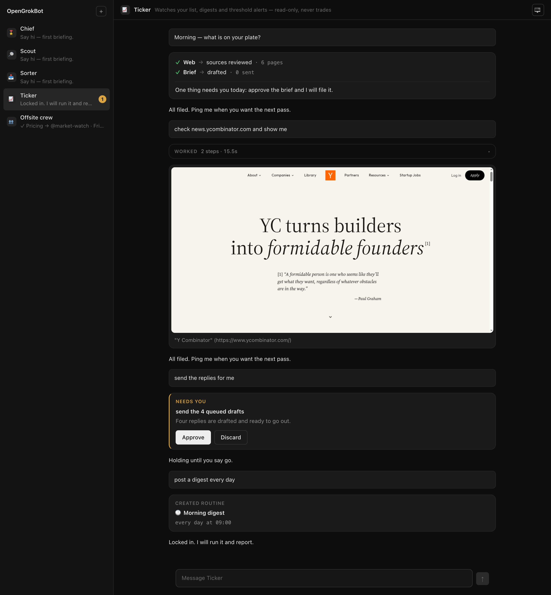
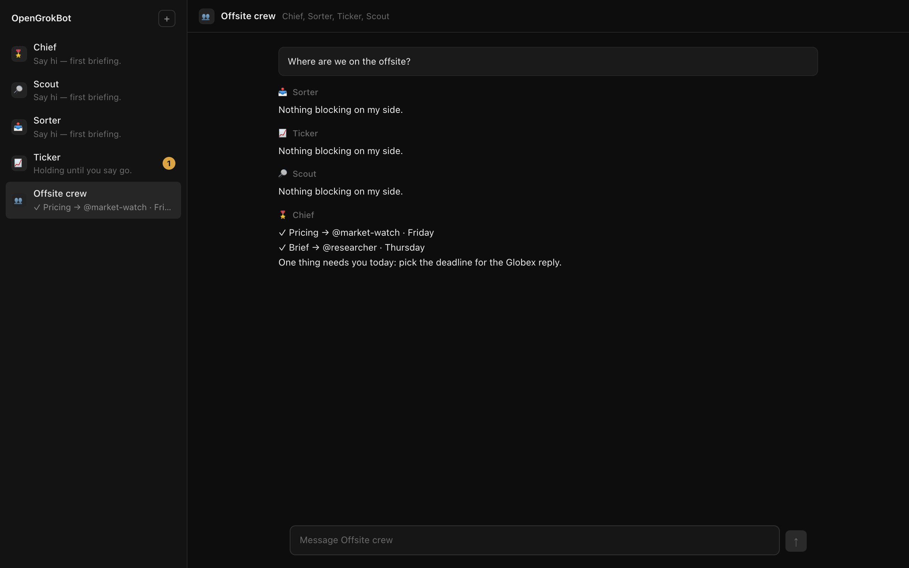
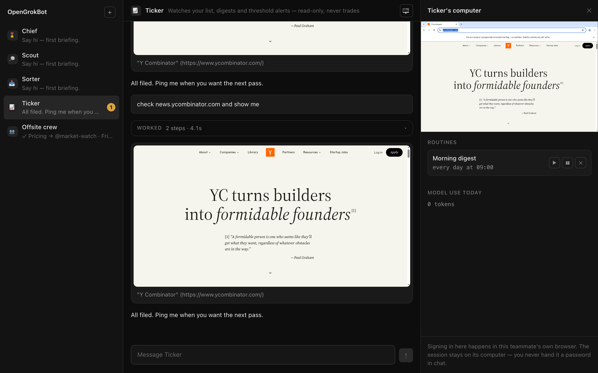
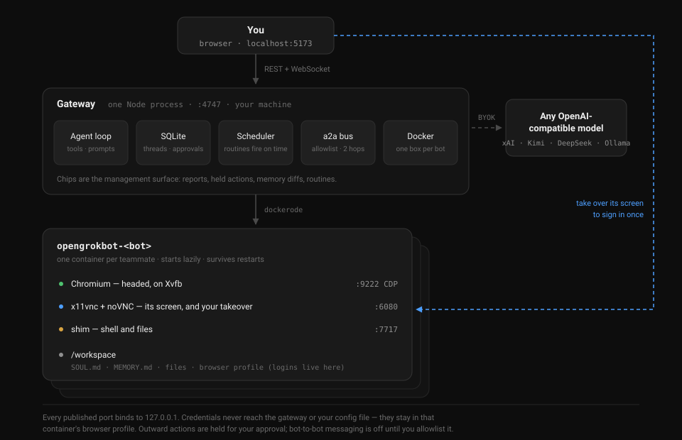

# OpenGrokBot 🦞🤖

> 一支随时在线的 AI 同事班子，**每个人一台自己的电脑**——跑在你自己的机器上，凭证在你自己手里。

[English](README.md) · [中文](README.zh-CN.md)

[](LICENSE)
[](../../pulls)

> 🖥️ **同一作者的另一个项目：[Grok Desktop](https://github.com/wolfqing/GrokDesktop)**——Grok Chat 与官方 `grok`
> 命令行的原生 macOS 客户端。Chat 内嵌 grok.com，Build 经 ACP 接着跑你 `~/.grok` 里的会话。

xAI 的 Grok Bot 卖的是「随时在线的同事」：每个 bot 配一台云电脑（浏览器、文件系统、终端），有持久记忆，彼此
能交接工作，还有一个 iMessage 形状的 app 来管他们。它跟着 Grok 和 Cursor 的付费订阅走，**用量另外计费**，而且
每个 bot 都跑在 xAI 的云上，**你的登录态也一起在里面**。

这个仓库是同样的形状，自托管版：你机器上一个 gateway 进程、每个 bot 一个 Docker 容器、一个信息密度很高、更像
工作台的网页客户端，后面接任何 OpenAI 兼容的模型。



<table>
<tr>
<td width="50%"></td>
<td width="50%"></td>
</tr>
<tr>
<td>在群里问一句——每位只报自己那摊，幕僚长收口发 <code>✓ 事项 → @谁 · 期限</code>。</td>
<td>它的电脑：可以接管去登录的实时屏幕，以及它排了哪些定时任务。</td>
</tr>
</table>

## 这里的「同事」到底是什么

一个文件夹（`SOUL.md` 写它是谁，`AGENTS.md` 写它怎么干活、硬边界在哪）、侧栏里的一条线程，外加一台自己的电脑：



凭证只存在**它的**浏览器 profile、**它的**容器里。gateway 看不到密码，配置文件里也不会有。

## 现在已经能做什么

下面每一条都已实现且有测试覆盖，没有一条是路线图。

**管理界面**

- **侧栏即组织架构。** 每个同事一条线程，外加群线程。预览显示的是完成态，扫一眼列表等于巡一遍工位。每个头像
  标着这位同事在干活、在等你、卡住了，还是在你看别处时干完了。琥珀色徽章标出等你拍板的审批和问题数，浏览器标签页
  标题带着总数。
- **统一的汇报语法。** 干完的活以 `✓ 系统 → 结果 · 数字` 回来，最后一句人话只说需要你决定的事。所有同事同一种
  格式。
- **默认扣住的审批链。** 任何要出门的动作都停在门口：chip 里写清到底会发出去什么、发给谁，配 Approve / Discard
  两颗按钮。在线程里发一个光秃秃的 👍 就放行最新那条。决议是幂等的——重复点击拿到 409，而不是发第二遍。同一个
  动作要发给很多人时，chip 会把每个对象列出来、各带一个勾：取消勾选几项，同事就只做剩下的。
- **由你划定的「以后都放行」。** 发给同一个去向的邮件、消息或帖子，可以点「Always allow…」：这次放行，之后
  这位同事再发同样的东西不用再问——一小时、一天，或直到你在电脑面板里撤销。花钱、预订和说不清是什么的动作永远
  要问。
- **点一下就能回答的问题。** 下一步是几个明确选项之一时，同事会贴一张带按钮的问题卡片，而不是列一大段选项，
  然后等你选。
- **看得见的记忆。** 「以后安静客户的邮件等我读过再发」会把这条规矩写进那个 bot 的 `MEMORY.md`，并把 diff 作为
  chip 贴出来；「忘掉那条规矩」用同样的方式删掉它，电脑面板也列出全部规矩、每条都能删。这个文件放在 bot 的电脑
  之外，所以每次改动都有一张 chip。
- **从对话里长出来的 routine。** 「以后每天发一份摘要」会登记一条 cron，用人话显示排期，重启后自动重载，同一条
  不会叠着跑。「每来一个新 issue 就……」则给这条 routine 一个带密钥的 webhook 地址，GitHub、表单或任何脚本都能
  调用它。「帮我盯着状态页」会建一条只看不动的 watch routine：只给只读工具，没事就不出声。可以在电脑面板里暂停、
  立即运行或删除，也可以直接让 bot 停掉某一条。
- **共享技能。** 往 `<数据目录>/skills/` 放一份 Markdown 做事手册，所有同事都能看到，做相关的活之前先读它。
  记忆和 routine 各归各，技能大家共用。
- **看得见在干什么，也停得下来。** 它在电脑上的每一步——跑的命令、开的网页、点的按钮——实时显示在一张卡片里，
  回合结束后折叠成一行。停止按钮随时结束这一轮。每一个动作还会记进日志，连同是谁让它开始的，在电脑面板里能看。
- **想要的话，还有预算。** `OPENGROKBOT_DAILY_TOKENS` 给每位同事设每日 token 上限，面板里能看到今天用了多少。

**电脑**

- 容器里的 `shell`、`read_file`、`write_file`；长文件、长网页分片读，不再被悄悄截断。
- `browser_goto` / `browser_extract`（附页面上的链接）/ `browser_click` / `browser_type` / `browser_press` /
  `browser_scroll` / `browser_back` 操作真正的有头 Chromium——登录墙后面的站点和表单都能干，这是纯 API/MCP
  方案做不到的。中文和 emoji 字体都装好了。
- `browser_screenshot` 把它看到的画面贴进聊天当证据；开 `OPENGROKBOT_VISION=1` 后也会给支持看图的模型看。
- **接管登录。** 撞上登录墙时，bot 调 `ask_for_login` 而不是问你要密码。你从线程里打开它的屏幕，在**它的**浏览器
  里登录一次，会话就留在它的 profile 里——容器重启也还在。
- 电脑按需启动，闲置一小时自动停机，下次用时连同登录态原样回来。每台都有内存 / CPU / 进程数上限，也碰不到别的
  同事的电脑。

**这支班子**

- **群线程。** 在群里问一句：每位同事只报自己那摊（并行作答），最后由幕僚长收口发分派表——`✓ 事项 → @bot ·
  期限`——再加一句今天需要你的是什么。
- **走白名单的交接。** `message_bot` 把一件划好范围的活丢进另一位同事的线程并叫醒他。默认只有幕僚长能联系所有
  人，同级互发要显式指定方向。转发最多两跳，两个 bot 不会互相回声。
- **从侧栏雇人。** 点 `+`、填个名字（中文也行）、一句职位描述。没有工作流编辑器，没有工具勾选清单——复杂度积累
  在使用过程中，而不是前置在表单里。

## 快速开始

需要 Node 22+ 和 pnpm。**Docker 可选。** 不装 Docker，每位同事得到一台「本机电脑」：在你机器上有它自己的浏览器
（有 Chrome / Edge / Chromium 就直接用，没有就自动下载一次）和自己的文件夹；Docker 开着时，每位同事得到一个
封闭的容器。本机电脑支持 macOS 和 Linux；Windows 请用 Docker。

```bash
git clone https://github.com/wolfqing/OpenGrokBot.git
cd OpenGrokBot
pnpm install
```

不用任何 API key 就能试——内置的脚本化假模型能把每条链路都跑通：

```bash
OPENGROKBOT_MODEL=stub pnpm dev
```

gateway 启动时会打印一条登录链接——`http://localhost:5173/auth?token=…`。每个浏览器打开一次即可；没有这个
令牌，什么都连不上 gateway。

接真模型（任何 OpenAI 兼容的都行：xAI、Kimi、DeepSeek、本地 Ollama）：

```bash
OPENGROKBOT_API_KEY=sk-… OPENGROKBOT_MODEL=grok-4 pnpm dev
```

gateway 启动时自己选电脑的种类并写进日志：Docker 守护进程应答就用 Docker，否则用本机模式
（`OPENGROKBOT_COMPUTERS=docker|local` 可以强制）。用 Docker 要先建镜像：`docker build -t opengrokbot/bot:dev docker/bot`。
本机电脑上**命令行默认关着**，在那位同事的电脑面板里按需打开；打开后命令跑在系统沙箱里（macOS 用 Seatbelt，
Linux 用 bubblewrap），只能写这位同事自己的文件夹。细节见 [docs/local-computers.md](docs/local-computers.md)。

想让它常驻——一个进程、一个端口、开机自启、经隧道远程访问——用 `pnpm build && pnpm start`，以及
[docs/always-on.md](docs/always-on.md) 里的 launchd / systemd 模板。

| 环境变量 | 默认值 | 作用 |
|---|---|---|
| `OPENGROKBOT_API_BASE` | `https://api.x.ai/v1` | 任何 OpenAI 兼容端点 |
| `OPENGROKBOT_API_KEY` | — | 你的 key，本仓库不会把它写进任何文件 |
| `OPENGROKBOT_MODEL` | `grok-4` | 填 `stub` 可离线零 key 运行 |
| `OPENGROKBOT_DATA` | `gateway/data` | SQLite、bot 数据、工作区、gateway 令牌 |
| `OPENGROKBOT_COMPUTERS` | `auto` | `docker`、`local`，或 `auto`（Docker 在跑就用 Docker，否则本机） |
| `OPENGROKBOT_BROWSER` | *(自动找)* | 本机电脑用的浏览器；不填就找 Chrome / Edge / Chromium，都没有就下载一个 |
| `OPENGROKBOT_BROWSER_MIRROR` | *(官方)* | 下载那个浏览器用的镜像主机，国内网络用 |
| `OPENGROKBOT_A2A_ALLOW` | *(空)* | 同级交接，如 `researcher>market-watch` |
| `OPENGROKBOT_DAILY_TOKENS` | `0`（不限） | 每位同事每天的 token 预算 |
| `OPENGROKBOT_VISION` | *(关)* | 把截图喂回给模型看 |

其余设置——监听地址、闲置停机、单台电脑的资源上限、超时——见
[docs/always-on.md](docs/always-on.md#configuration)。

国内网络：用 Docker 的话挂镜像源构建——`docker build --build-arg APT_MIRROR=mirrors.aliyun.com …`（某个源不稳就换
`mirrors.huaweicloud.com` 或 `mirrors.tuna.tsinghua.edu.cn`；apt 会自动重试，单个包最多等 5 分钟）；本机电脑需要
下载浏览器的话，设 `OPENGROKBOT_BROWSER_MIRROR=https://cdn.npmmirror.com/binaries/playwright`。

## 安全不是脚注，是全部理由

对「托管式常驻 agent」最响的反对声：一个永不休眠、手握你全部凭证的 agent，跑在别人的基础设施上，还暴露在提示词
注入面前。自托管的回答是：

- **凭证不出你的机器。** 它们在 bot 的浏览器 profile 里，在它自己的工作区里。
- **bot 不会在聊天里问密码。** 它只会请你接管它的屏幕。
- **没有令牌，什么都连不上 gateway。** 它只听 `127.0.0.1`，每个浏览器登录一次，且只有它自己的页面能改状态。你随手
  打开的网页放行不了审批——bot 自己也放行不了。
- **每个 bot 各在各的笼子里**——独立容器、独立工作区、资源上限，而且没有通往别的同事电脑的路。
- **规矩只能经记忆 chip 改。** bot 没法悄悄改写你交代过的话。
- **对外动作会扣住等你批准。** 这是每位同事都遵守的指令，而不是沙箱规则——所以给 bot 配它们自己的账号，别用你的。
- **bot 之间默认不能互发消息**，要你显式放行方向。

哪些是代码强制的、哪些只是约定、哪些仍然要你自己把关，[docs/security.md](docs/security.md) 里写得清清楚楚。

## 成本

| | Grok Bot | OpenGrokBot |
|---|---|---|
| 软件 | 需要 SuperGrok 或 Cursor 付费订阅，用量另计 | $0（一路 MIT） |
| 算力 | 含（xAI 的云） | 你现有的 Mac / 小主机 / ~$5 VPS |
| 模型 | 含（只有 Grok） | 你自己的 key，任意厂商——本地模型则 $0 |
| 你的登录态 | 在 xAI 云上 | 在你机器上的容器里 |

说句公道话：Grok Bot 的开箱即用、iOS app、看着你操作就学会，这三样是真优势。如果你不介意把账号放在 xAI 云上，
也愿意为省事付钱，那就买它。这个仓库是给那些对「你能接受吗？」回答**不能**的人准备的。

## 姊妹项目：Grok Desktop

OpenGrokBot 管的是你不在电脑前时发生的工作。你自己泡在 Grok 里的那些时间，可以用
**[Grok Desktop](https://github.com/wolfqing/GrokDesktop)**：macOS 14+ 的原生 SwiftUI 窗口，Chat 内嵌 grok.com，
Build 驱动你本机的 `grok` 命令行——会话按项目分组，Markdown、计划、diff、实时终端都在右侧检查器里，Imagine
也不用离开窗口。免费、社区作品、非 xAI 官方产品。[下载最新版本](https://github.com/wolfqing/GrokDesktop/releases/latest)。

## 路线图

- [ ] **teach-mode**——录一遍浏览器操作，编译成可复用的 routine。这是 Grok Bot 唯一没有开源等价物的能力，设计
      讨论在 [#1](../../issues/1)
- [ ] Telegram 作为离开电脑时的通知 / 审批补位渠道
- [ ] **不用 Docker 的电脑**——本机模式（每位同事独立的浏览器配置、命令行在系统沙箱里）加上带首次启动向导的
      桌面 App，试用时不需要 Docker、Node 和终端。计划见 [docs/local-computers.md](docs/local-computers.md)
- [ ] 一条命令起 VPS 镜像（cloud-init）

## 常见问题

**和 Grok Bot 是什么关系？** 同一件事——常驻同事、各自的电脑、持久记忆、互相交接——但托管模型相反，且**零共享
代码**（Grok Bot 闭源，根本无从 fork）。它甚至可以用同一个大脑：把 API 指向 Grok 即可。

**和 OpenClaw 是什么关系？** 本仓库 v0.1 是 OpenClaw 之上的一个发行版。v0.2 换成了自研核，因为「每个同事一台
自己的电脑」和 OpenClaw 的共享主机模型是拧着的。旧配方保留在
[docs/openclaw-recipe/](docs/openclaw-recipe/README.md)。本项目不是 OpenClaw 官方项目。

**必须用 Docker 吗？** 电脑那部分目前必须，不用 Docker 的本机模式在计划中（见
[docs/local-computers.md](docs/local-computers.md)）。其余能力——线程、审批、记忆、routine、群分派——没有 Docker
也照常运转，bot 只会如实说自己现在没有电脑。

更多见 [docs/faq.md](docs/faq.md) · [docs/multi-bot.md](docs/multi-bot.md) · [docs/always-on.md](docs/always-on.md) ·
[docs/security.md](docs/security.md) · [docs/comparison.md](docs/comparison.md) · [CHANGELOG.md](CHANGELOG.md)

## 免责声明

非官方项目，与 xAI 或 OpenClaw Foundation 无任何隶属、背书或关联关系。"Grok" 是 xAI 的商标，此处仅用于指明本项目
所对标的产品。

## License

[MIT](LICENSE)。如果它帮你省下每月 $300，点个 star。⭐
